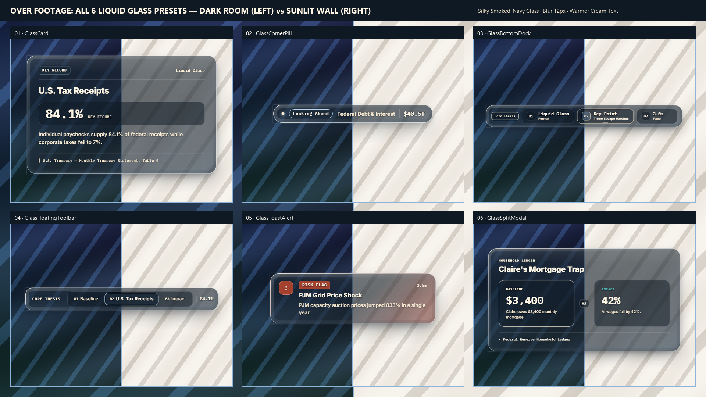
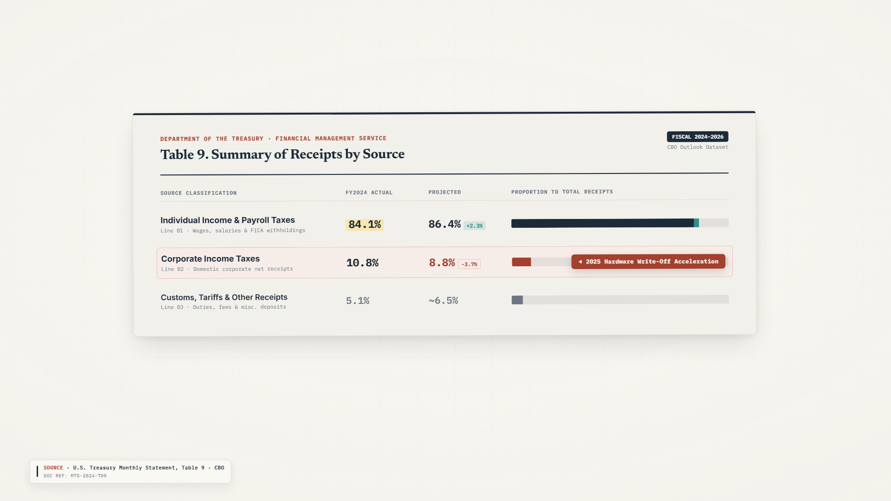

# The Reading Room Video Studio

Frame-accurate Remotion graphics engine, AI transcript director, and DaVinci Resolve FCPXML pipeline for **The Reading Room** documentary edits.


## Visual System: Dual Palette

Every beat follows strict scene separation between full-screen documentary cutaways and camera overlays. See [`docs/STYLE_CATALOG.md`](docs/STYLE_CATALOG.md) for exact line-by-line links across all **24 visual styles** and **11 core system modules**.

| Mode | Canvas / Surface | Typography & Accents |
|---|---|---|
| **Page (`PAGE_PALETTE`)** | Milk canvas `#FAF8F3`, card ground `#F2F0EA`, rule `#E1DED5` | Classic dark navy `#1C2B3A` hero bars, map highlights, and ink; teal `#2F8F8B` secondary series; yellow sweep `rgba(255, 213, 79, 0.38)`; brick red `#A3402E` + blush risk `#F8ECE8`/`#E6C3B9` |
| **Over Footage (`OVER_FOOTAGE_PALETTE`)** | Smoked-navy glass `rgba(28, 43, 58, 0.64)` to `rgba(15, 25, 35, 0.60)` with `blur(12px) saturate(165%) brightness(0.66)` | Warm cream `#FFF6E5` headlines, `#FAECD4` body copy, `#F7E8CE` captions, `#4FB3AE` teal deltas, `#E27358` risk text, `#A3402E` solid chips, tight `0 1px 2px rgba(8, 14, 22, 0.85)` shadow |

<details>
<summary>Preview Gallery: Liquid Glass Presets, Treasury Table 9, and PJM Grid Map</summary>





</details>

## Repository Layout

- `studio/`: Remotion `4.0.544` TypeScript studio (`src/design/`, `src/components/glass/`, `src/motion/`, `src/styles/`, `src/typography/`, `src/director/`, `src/compositions/`), LUTs (`luts/`), procedural SFX assets (`public/sfx/`), environment template (`.env.example`), and Node CLI scripts (`scripts/`).
- `tools/`: Pinned Python dependencies (`requirements.txt`), transcription (`transcribe.py`), MediaPipe/Gemini room swap utilities (`room_object_swap.py`), media verification (`benchmark_media.py`), and master orchestrator (`run_pipeline.mjs`).
- `docs/`: Full style and module code index ([`STYLE_CATALOG.md`](docs/STYLE_CATALOG.md)) and compressed reference stills (`docs/previews/`).
- `scripts/`: Script source files (`scripts/1/19.4.md`).
- Sibling script-writing skills repository: [Yuzakhodayari/channel-script-skills](https://github.com/Yuzakhodayari/channel-script-skills).

## Quick Setup

### One-Command Installer

Run from the repository root. Both scripts verify Node.js `>= 20`, check or install `ffmpeg` and `uv`, create a Python 3.12 environment at `tools/.venv` from [`tools/requirements.txt`](tools/requirements.txt), download `tools/models/selfie_segmenter.tflite` (~244 KB), install `studio/` npm packages, build SFX WAVs, and run `npm run lint`.

**Windows (PowerShell):**
```powershell
.\setup.ps1
```

**macOS / Linux:**
```bash
chmod +x setup.sh
./setup.sh
```

Optional installer flags:
- `-WithScriptSkills` / `--with-script-skills`: clones `Yuzakhodayari/channel-script-skills` into `channel-script-skills/`.
- `-WithUpstreamRefs` / `--with-upstream-refs`: clones third-party upstream reference repositories (`lemomo-ai/lemo-opuscar`, `Vincentwei1021/mg-styles-15`) into `_refs/`.
- `-SkipModelDownload` / `--skip-model-download`: skips downloading `selfie_segmenter.tflite`.

If you plan to run Gemini image or video room swaps (`tools/room_object_swap.py`), copy [`studio/.env.example`](studio/.env.example) to `studio/.env` and set `GEMINI_API_KEY`.

## Usage & Pipeline Commands

Run commands inside `studio/` unless noted otherwise:

- **Preview interactively in Remotion Studio:**
  ```bash
  npm run dev
  ```
- **Generate a Director edit plan from a script or transcript:**
  ```bash
  npm run plan
  ```
- **Render beats (`H.264` MP4 cutaways + `VP9`/`ProRes 4444` alpha overlays):**
  ```bash
  npm run render:beats
  ```
- **Export a DaVinci Resolve FCPXML timeline:**
  ```bash
  npm run fcpxml
  ```
- **Run the end-to-end A-roll pipeline (prep, Whisper transcription, edit plan, optional renders, FCPXML):**
  ```bash
  npm run pipeline -- ../raw_aroll.mp4 --name episode_01 --script ../scripts/1/19.4.md --lut editorial-warm --cut-silence --render
  ```
  Output lands in `projects/<name>/`. Import `timeline.fcpxml` directly into DaVinci Resolve Free via **File > Import > Timeline**.

## Verification

Run the Node/Remotion benchmark and full PIL/NumPy/FFmpeg verification suite from `studio/`:

```bash
npm run lint
node scripts/benchmark-exam.mjs
..\tools\.venv\Scripts\python.exe ..\tools\benchmark_media.py
```

`benchmark-exam.mjs` verifies all 24 style mappings, 57 motion primitives, typography pacing, director retention constraints, 32 PNG still renders, H.264/VP9/ProRes render speed, and pixel contrast/color compliance. `benchmark_media.py` additionally runs A-roll prep, Whisper transcription, MediaPipe/Gemini room swap workflows, DaVinci FCPXML integrity, alpha-channel checks, and live end-to-end pipeline execution.
