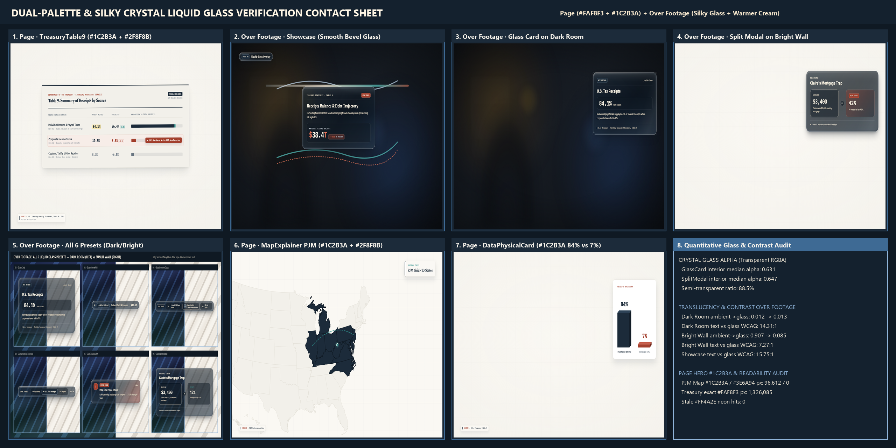
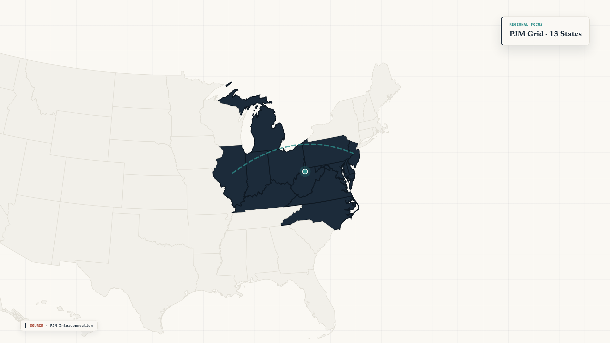

# The Reading Room Video Studio

Frame-accurate Remotion graphics engine, AI transcript director, and DaVinci Resolve FCPXML pipeline for **The Reading Room** documentary edits.



## Visual System: Dual Palette

Every beat follows strict scene separation between full-screen documentary cutaways and camera overlays:

| Mode | Canvas / Surface | Typography & Accents |
|---|---|---|
| **Page (`PAGE_PALETTE`)** | Milk canvas `#FAF8F3`, card ground `#F2F0EA`, rule `#E1DED5` | Classic dark navy `#1C2B3A` hero bars, map highlights, and ink; teal `#2F8F8B` secondary series; yellow sweep `rgba(255, 213, 79, 0.38)`; brick red `#A3402E` + blush risk `#F8ECE8`/`#E6C3B9` |
| **Over Footage (`OVER_FOOTAGE_PALETTE`)** | Smoked-navy glass `rgba(28, 43, 58, 0.64)` to `rgba(15, 25, 35, 0.60)` with `blur(12px) saturate(165%) brightness(0.66)` | Warm cream `#FFF6E5` headlines, `#FAECD4` body copy, `#F7E8CE` captions, `#4FB3AE` teal deltas, `#E27358` risk text, `#A3402E` solid chips, tight `0 1px 2px rgba(8, 14, 22, 0.85)` shadow |

<details>
<summary>Preview Gallery: Liquid Glass Presets, Treasury Table 9, and PJM Grid Map</summary>




</details>

## Repository Layout

- `studio/`: Remotion `4.0.544` TypeScript studio (`src/design/`, `src/components/glass/`, `src/motion/`, `src/styles/`, `src/typography/`, `src/director/`, `src/compositions/`), LUTs (`luts/`), procedural SFX assets (`public/sfx/`), and Node CLI scripts (`scripts/`).
- `tools/`: Python transcription, MediaPipe/OpenCV room swap utilities, media verification (`transcribe.py`, `room_object_swap.py`, `benchmark_media.py`), and the master orchestrator (`run_pipeline.mjs`).
- `scripts/`: Script source files (`scripts/1/19.4.md`).
- `docs/previews/`: Compressed PNG reference stills for documentation.

## Setup

### 1. Node & Remotion Studio
```bash
cd studio
npm install
npm run sfx:build
npm run lint
```

### 2. Python Tooling (`tools/.venv`)
Requires Python 3.12 (`tools/.venv`) with `faster-whisper`, `soundfile`, `opencv-python`, `mediapipe`, `numpy`, and `Pillow`, plus `ffmpeg` and `ffprobe` on `PATH`.

## Usage & Pipeline Commands

Run commands inside `studio/` unless noted otherwise:

- **Preview interactively in Remotion Studio:**
  ```bash
  npm run dev
  ```
- **Generate a Director edit plan from a script or transcript:**
  ```bash
  npm run plan
  ```
- **Render beats (`H.264` MP4 cutaways + `VP9`/`ProRes 4444` alpha overlays):**
  ```bash
  npm run render:beats
  ```
- **Export a DaVinci Resolve FCPXML timeline:**
  ```bash
  npm run fcpxml
  ```
- **Run the end-to-end A-roll pipeline (prep, Whisper transcription, edit plan, optional renders, FCPXML):**
  ```bash
  npm run pipeline -- ../raw_aroll.mp4 --name episode_01 --script ../scripts/1/19.4.md --lut editorial-warm --cut-silence --render
  ```
  Output lands in `projects/<name>/`. Import `timeline.fcpxml` directly into DaVinci Resolve Free via **File > Import > Timeline**.

## Verification

Run the Node/Remotion benchmark and automated PIL/NumPy readability audit from `studio/`:

```bash
npm run lint
node scripts/benchmark-exam.mjs
python ../tools/benchmark_media.py
```

`benchmark-exam.mjs` verifies all 24 style mappings, 57 motion primitives, typography pacing, director retention constraints, 32 PNG still renders, H.264/VP9/ProRes render speed, and pixel-level contrast/color compliance.
